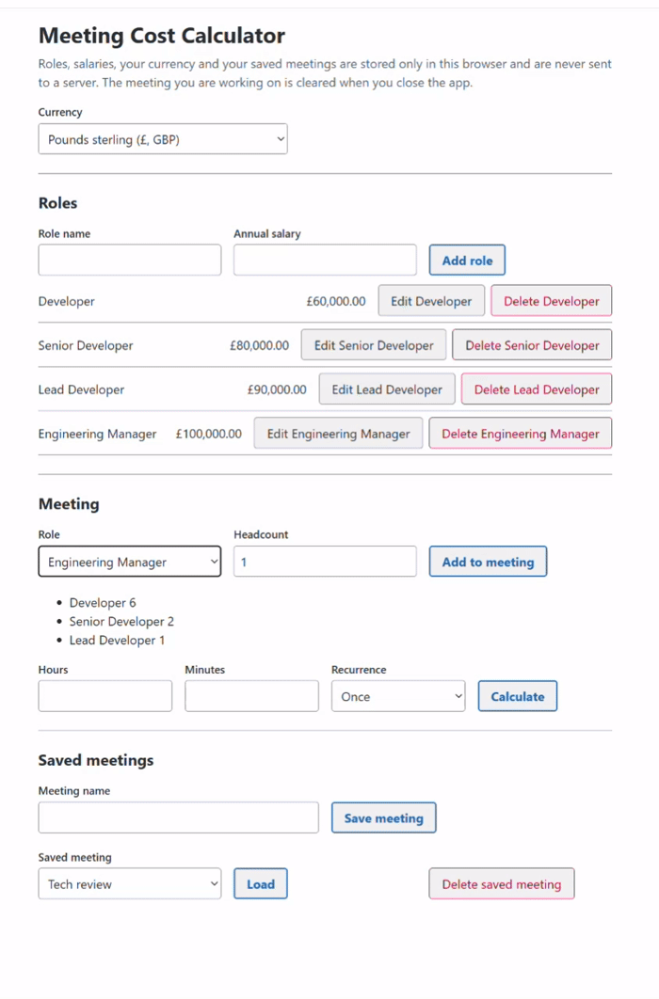

# Meeting Cost Calculator

Shows a manager what a meeting costs in money, from who attends and how long it runs, and what that adds up to per month and per year if it recurs. Meetings you hold again and again can be saved by name and reloaded with today's salaries. It supplies the number; the manager decides whether the meeting is worth it.

The value here isnt the meeting cost calculator it is the spec used to build it and the process I followed. 



## Live demo

https://aeichner81.github.io/meeting-cost-calculator/

Add roles with an annual salary, build a meeting from roles and headcount, enter the duration and press Calculate. Save the meeting under a name to load it again on a later visit. Roles, currency and saved meetings stay in your browser's local storage and are never sent to a server. The meeting you are working on is cleared when you close the app.

## What this repo demonstrates

Spec-driven development with an AI agent (Claude Code). The code is the smaller part of the deliverable. The commit history, tags and the `specs/` and `docs/` folders show how the work was controlled:

- **The spec is the source of truth.** Two approved specs hold 11 user stories, 40 acceptance criteria (AC-1 to AC-40), 9 accessibility requirements (A11Y-1 to A11Y-9) and 6 visual design requirements (UX-1 to UX-6). The agent is told never to build behaviour that is not in an approved spec, and to stop and propose a spec change if the spec is unclear or wrong.
- **Plan and tasks before code.** `docs/PLAN.md` records the architecture and the decisions. `docs/TASKS.md` splits the build into 29 small tasks, each naming the criteria it satisfies.
- **Tests first, one task at a time.** Each task writes tests for its criteria, then the code, then runs tests, lint and build, and stops for review. Each task is one commit.
- **Changes go through the spec.** Behaviour found in an audit became spec 001 revision 2 before it was built. A new feature, saving meetings, became spec 002, with its own plan and tasks.
- **Traceability.** `docs/TRACEABILITY.md` links every requirement to the tests that check it and the code that delivers it. A test (`src/docs.test.ts`) fails if a criterion in either spec has no row, a row has no test or code, or a row names a file that does not exist.

## The workflow

```
Spec -> Review -> Plan -> Tasks -> Test-first build -> Verify -> Change via spec
```

| Stage | Output | Marker |
|-------|--------|--------|
| Spec | `specs/001-meeting-cost-calculator.md` | tag `spec-approved` |
| Plan | `docs/PLAN.md`, `docs/TASKS.md`, `docs/TRACEABILITY.md` | tag `plan-approved` |
| Build | tasks 1 to 16, one commit each | commits `task 1` to `task 16` |
| Verify | `docs/TRACEABILITY.md` completed and audited, gaps listed | task 17 |
| Change via spec (revision) | spec 001 revision 2: AC-25, AC-26, UX-1 to UX-6 | tasks 18 to 20, tag `v1.0` |
| Change via spec (new feature) | `specs/002-persistent-meetings.md`, plan section and tasks | tag `plan-002-approved`, tasks 21 to 29, tag `v1.1` |

## Follow the story

1. Spec approved (2026-10-20): [`spec-approved`](https://github.com/aeichner81/meeting-cost-calculator/tree/spec-approved)
2. Plan approved (2026-10-20): [`plan-approved`](https://github.com/aeichner81/meeting-cost-calculator/tree/plan-approved)
3. Build, tasks 1 to 16 (2026-10-22 to 2026-11-04), and the wrap-up and audit, task 17 (2026-11-08): [commit history](https://github.com/aeichner81/meeting-cost-calculator/commits/main)
4. Spec 001 revision 2 and its tasks 18 to 20, ending with the visual design pass (2026-11-09): [`v1.0`](https://github.com/aeichner81/meeting-cost-calculator/tree/v1.0)
5. Spec 002 approved (2026-11-19): [commit `bf91270`](https://github.com/aeichner81/meeting-cost-calculator/commit/bf91270)
6. Spec 002 plan approved (2026-11-19): [`plan-002-approved`](https://github.com/aeichner81/meeting-cost-calculator/tree/plan-002-approved)
7. Saved meetings, tasks 21 to 29 (2026-11-20): [`v1.1`](https://github.com/aeichner81/meeting-cost-calculator/tree/v1.1)

Documents: [`specs/`](specs), [`docs/PLAN.md`](docs/PLAN.md), [`docs/TASKS.md`](docs/TASKS.md), [`docs/TRACEABILITY.md`](docs/TRACEABILITY.md), [`docs/Build-log.md`](docs/Build-log.md) (my diary while building).

## What I learned

- **The spec review is the human in the loop.** It's where quality is
  maintained and ambiguity is removed. I hadn't designed the UI up front, so
  as it was built it became unwieldy to use. I added a new user story (US-8)
  to fix that. Fixing it in the spec was far cheaper than fixing it in code.
- **Plan mode made me check the agent's thinking before it acted.** The agent
  first read the spec as requiring saved meeting requests. I pushed back on
  that for phase 1 and moved it into a separate spec, to be built once the
  initial functionality was delivered.
- **Small tasks kept the agent honest.** Each piece of functionality stayed
  manageable, and the agent never had to guess or run for long without human
  review.
- **What didn't work:** I stopped keeping the build log after task 2. The
  early entries were positive ("boilerplate nicely formed", about 2 minutes),
  but I lost the detail on timings and surprises. Next time I'd write the log
  entry in the same commit as each task.

From the history of the repo:

- **A test exposed a gap in the spec.** The first version of AC-4 only covered invalid salaries, so blank role names got through. The fix (`task 4-b`) changed the spec wording first, then the test and the code, in one commit.
- **An audit turned unspecified behaviour into spec decisions.** The task 17 audit found the app doing things no criterion asked for, such as removing a deleted role's line from the meeting. Rather than keep or drop them silently, they became AC-25 and AC-26 in spec 001 revision 2. Two smaller questions are still recorded as open in the spec.
- **An accessibility baseline is only half testable in jsdom.** Labels, heading order, error links, live regions, tab order and stylesheet rules (focus outlines, contrast, target sizes) are checked automatically. Real focus rings, browser zoom, arrow keys in selects and a screen reader are not, so they stay on an open checklist in `docs/TRACEABILITY.md` rather than being ticked off.
- **A new dependency is a decision, not a convenience.** `jest-axe` would automate the axe check but adds a dependency, which the project rules say to ask about first, so it was left out and the check remains manual.

## Numbers

Counted from the repo at tag `v1.1`.

| | |
|---|---|
| Calendar time | 2026-10-20 (spec approved) to 2026-11-20 (`v1.1`) |
| Hands-on time | [5 hours] |
| Commits | 36 |
| Tasks | 29, plus one follow-up fix (`task 4-b`) |
| Specs | 2 (spec 001 at revision 2, spec 002) |
| User stories | 11 (8 in spec 001, 3 in spec 002) |
| Acceptance criteria | 40 (26 in spec 001, 14 in spec 002) |
| Accessibility and design requirements | 9 (A11Y-1 to A11Y-9) and 6 (UX-1 to UX-6) |
| Automated tests | 467 in 23 test files, all passing |
| Runtime dependencies | 2 (React and React DOM) |
| Open manual checks | 6, listed in `docs/TRACEABILITY.md` |

## Run it locally

```bash
npm install
npm run dev     # http://localhost:5173/meeting-cost-calculator/
npm test        # Vitest and React Testing Library
npm run lint
npm run build
```

Pushing to `main` runs the tests, lint and build, then deploys `dist/` to GitHub Pages (`.github/workflows/deploy.yml`).
